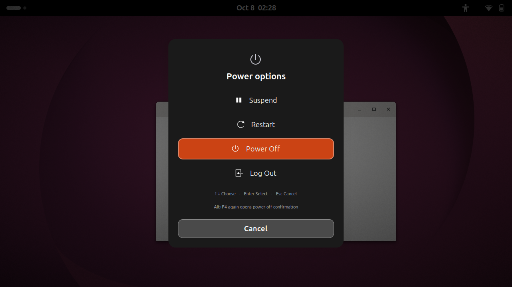

# Desktop Alt+F4

A keyboard-accessible power menu for the GNOME desktop.

Press **Alt+F4 on the desktop** to choose Suspend, Restart, Power Off, or Log Out.
Application windows keep their normal Alt+F4 close behavior.



## Keyboard controls

| Key | Action |
| --- | --- |
| Alt+F4 on the desktop | Open the menu, with Power Off selected |
| Arrow keys | Move between available actions |
| Enter | Run the selected action |
| Alt+F4 again | Request Power Off, regardless of the selected action |
| Esc | Cancel |

Mouse selection and a Cancel button are also available. Holding the opening
Alt+F4 press does not count as a second press. **The second press is a shutdown
request**, not a shortcut to close this menu.

Shutdown and restart go through GNOME Session Manager. The extension skips only
the redundant ordinary confirmation for its own request. GNOME still displays
its dialog when applications inhibit shutdown, another user session is present,
updates require a choice, or the extension cannot check the dialog safely.

## Compatibility

- **GNOME Shell 50 only**, currently tested on Ubuntu 26.04 with GNOME Shell 50.1.
- Tested with Wayland, Desktop Icons NG, and with no focused desktop window.
- This is a GNOME Shell extension, not a general Linux, KDE, Windows, or macOS app.
- Uses the existing window-close shortcut (normally Alt+F4). Leave that shortcut
  at its default for the documented behavior. The no-window fallback uses Alt+F4.
- Avoid enabling another extension that overrides the window-close handler.
- Available power options depend on the capabilities and policies of your session.

## Install

1. Download the `.shell-extension.zip` from the [latest release](https://github.com/yagyaanshK/gnome-shell-extension-desktop-alt-f4/releases/latest).
2. Install it from a terminal:

   ```sh
   gnome-extensions install --force desktop-alt-f4@yagyaanshK.github.io.shell-extension.zip
   ```

3. Log out and log back in so GNOME can discover the extension.
4. Enable it in the Extensions app, or run:

   ```sh
   gnome-extensions enable desktop-alt-f4@yagyaanshK.github.io
   ```

Click an empty part of the desktop and press Alt+F4. In an application, Alt+F4
continues to close that application window.

This release is distributed on GitHub. GNOME Extensions rejected the first
submission on **1 October 2026**, citing AI-generated code and its requirement
for a maintainer who understands and can maintain the JavaScript. It is not
approved or listed for installation there. Addressing a linter warning alone
does not resolve that review. See [GNOME's maintainership guidance](https://gjs.guide/extensions/review-guidelines/best-practices.html#submissions-require-maintainership).

Do not bypass GNOME's version check to install it on an unsupported version.

If you used a privately installed prototype, disable it in the Extensions app
before enabling this public version. They must not run together. Public releases
use the UUID shown above.

## Disable or uninstall

```sh
gnome-extensions disable desktop-alt-f4@yagyaanshK.github.io
gnome-extensions uninstall desktop-alt-f4@yagyaanshK.github.io
```

Disabling removes the menu and restores GNOME's native window-close handler.
No system files, global confirmation settings, or other extensions are changed.

## Privacy

The extension has no network requests, telemetry, clipboard access, or persistent
user-data storage. It handles shortcut events and communicates with the local
GNOME session and login services to show and perform power actions.

## Build and test

Building uses Python 3's standard library:

```sh
python3 tools/package.py
```

The resulting ZIP and SHA-256 checksum are placed in `dist/`. The ZIP contains
only the runtime JavaScript, stylesheet, metadata, and license.

For an integration test on GNOME Shell 50 with GJS, Python PyGObject/GTK 4,
`dbus-run-session`, and `fusermount3` installed:

```sh
python3 tests/smoke.py
```

The test starts a separate headless GNOME session with isolated HOME, XDG
folders, D-Bus, and settings. It injects virtual keyboard events into test
windows and **stubs all final power actions**. It covers window closing, menu
navigation, cancellation, repeated-key handling, confirmation safeguards, the
native GNOME confirmation dialog, and disable cleanup. Do not replace the action
stubs with real shutdown calls.

See [MAINTAINING.md](MAINTAINING.md) for implementation details and release checks.
Report problems through [GitHub Issues](https://github.com/yagyaanshK/gnome-shell-extension-desktop-alt-f4/issues), including GNOME version, distribution, and reproduction steps.

## License and authorship

Copyright © 2026 Yagyaansh Khaneja and contributors.
Licensed under **GPL-2.0-or-later**; see [LICENSE](LICENSE).

Developed with OpenAI Codex assistance. The initial behavior was tested in an
isolated GNOME session and confirmed by its user on Ubuntu. Community testing
and review are welcome; broader compatibility is not yet claimed.
